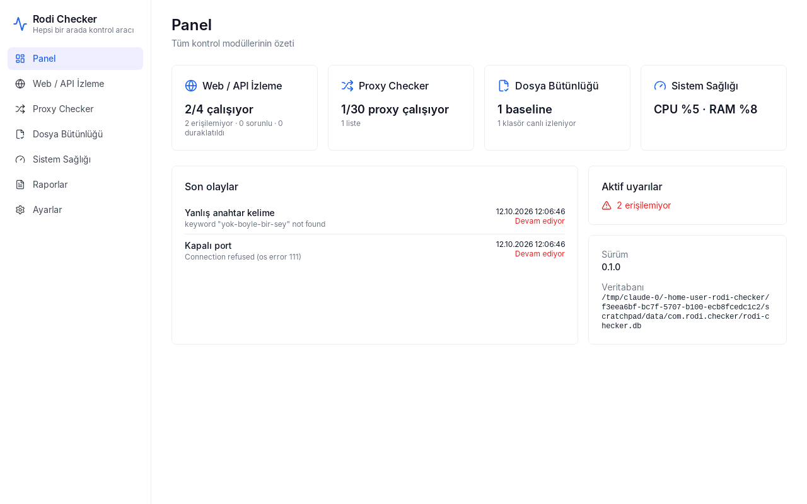
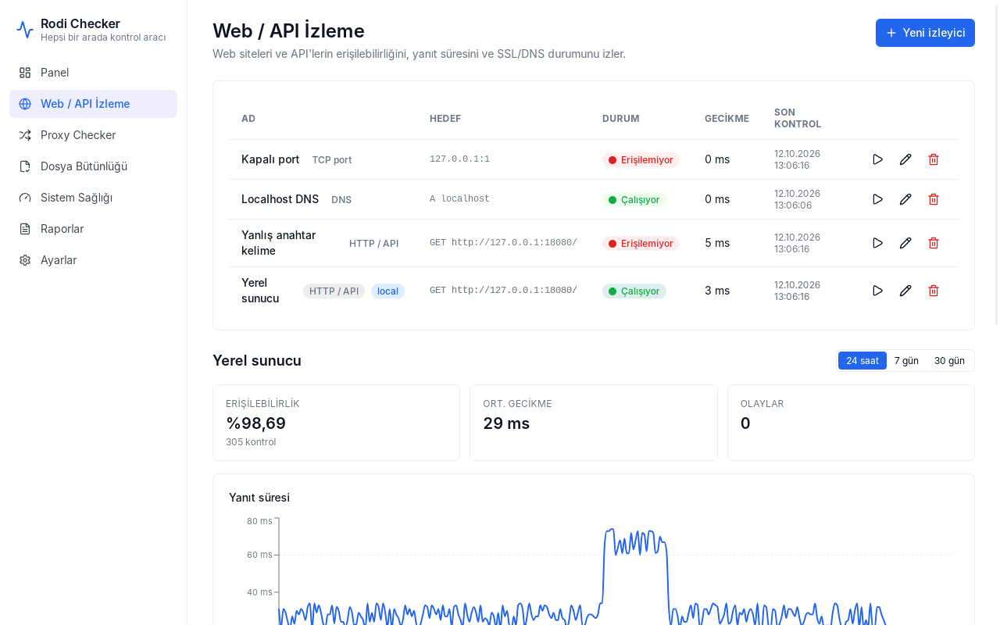
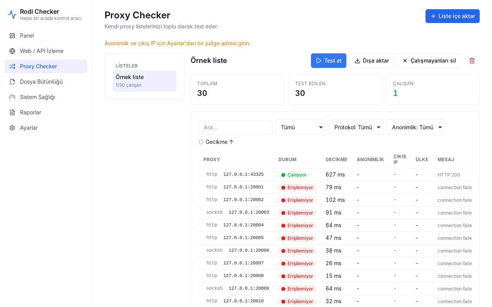
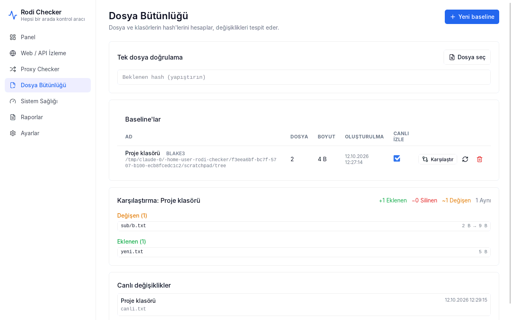
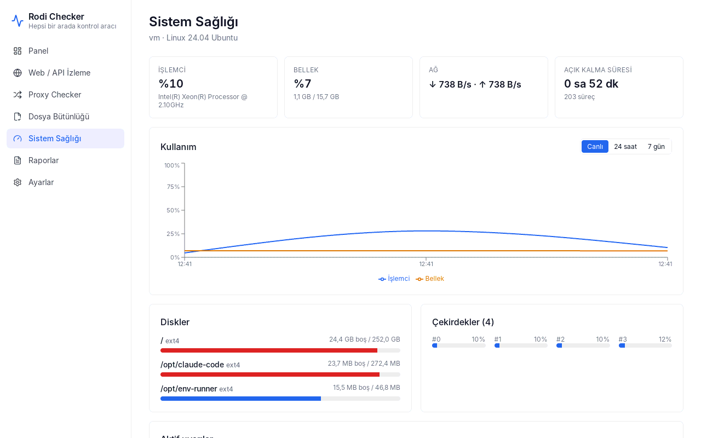
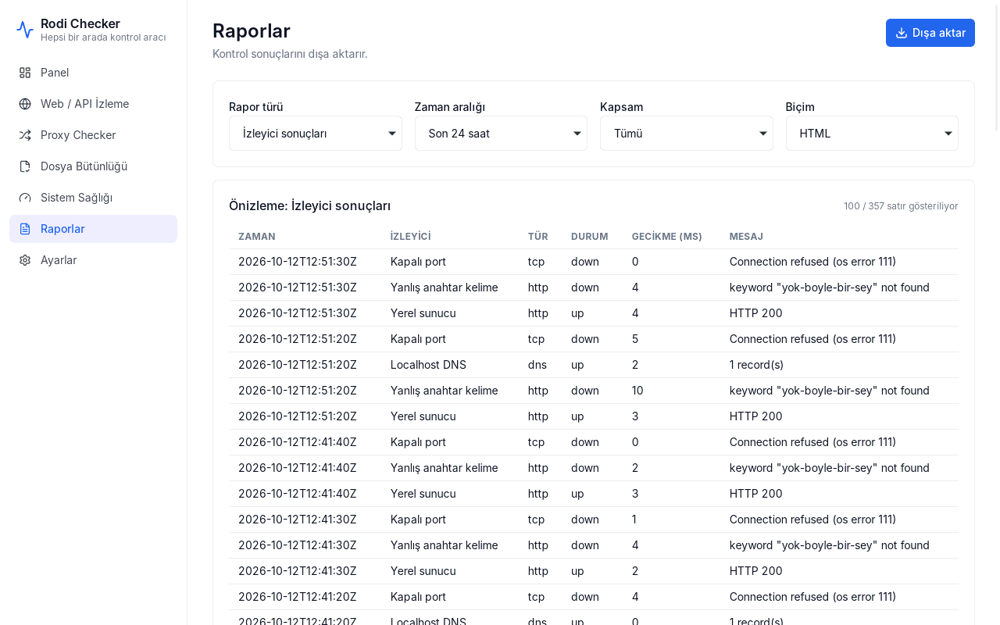
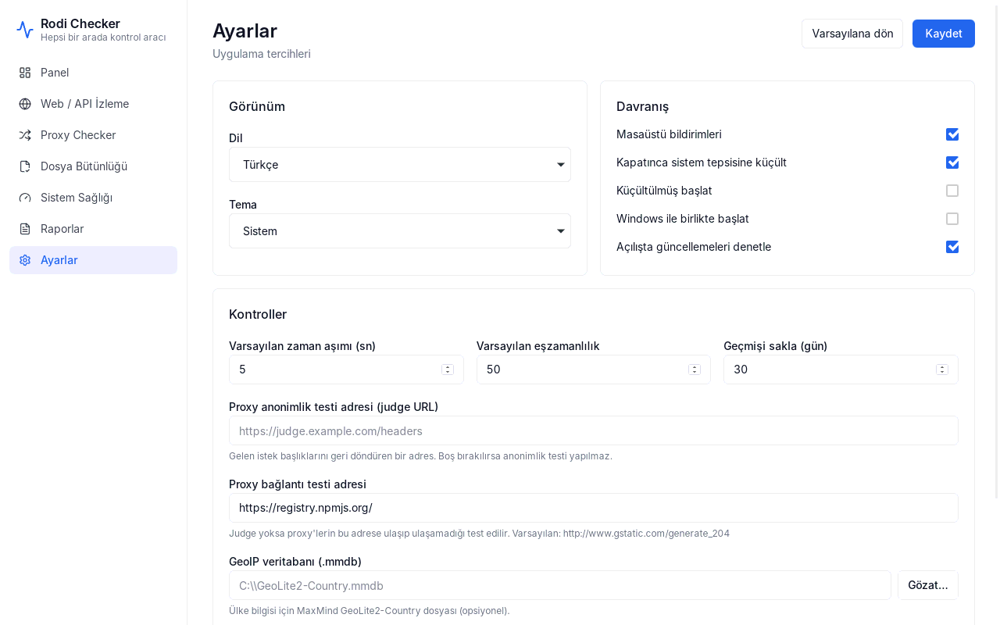
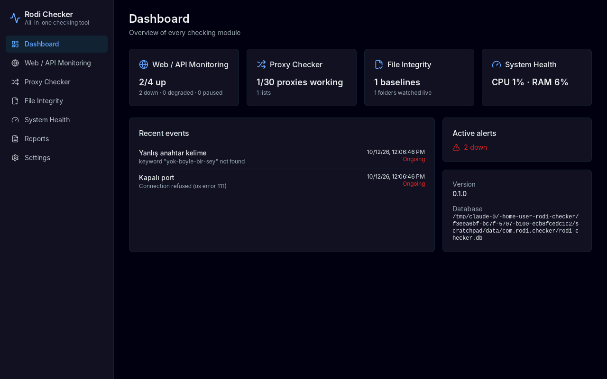

# Rodi Checker

Rust + **Tauri 2** ve **Next.js + Tailwind CSS** ile yazılmış, Windows için hepsi bir arada kontrol uygulaması. Arayüz Türkçe ve İngilizce, açık ve koyu temalıdır. Aynı çekirdeği kullanan bir komut satırı aracı (`rodi-checker.exe`) da içerir.



## Modüller

| Modül | Neler yapar |
|---|---|
| 🌐 **Web / API İzleme** | HTTP durum kodu, yanıt süresi, anahtar kelime kontrolü, SSL sertifikasının bitişi, DNS kayıtları ve TCP port kontrolü. Zamanlanmış kontroller, uptime yüzdesi, yanıt süresi grafiği ve olay (kesinti) geçmişi |
| 🧦 **Proxy Checker** | Kendi HTTP / HTTPS / SOCKS4 / SOCKS5 listelerinizi toplu test eder: çalışıyor mu, gecikme, çıkış IP'si, anonimlik seviyesi (şeffaf / anonim / elit) ve ülke (GeoIP). İçe aktarma, filtreleme ve TXT/CSV dışa aktarma |
| 📁 **Dosya Bütünlüğü** | SHA-256 / BLAKE3 ile paralel hash hesaplama, klasörün o anki halini "baseline" olarak kaydetme, sonradan karşılaştırma (eklenen / silinen / değişen), canlı klasör izleme, tek dosyayı verilen bir hash ile doğrulama |
| 🖥️ **Sistem Sağlığı** | Canlı CPU (çekirdek başına), RAM, disk, ağ ve sıcaklık bilgisi, süreç listesi, dinleyen portlar, Windows servisleri ve eşik uyarıları (CPU, RAM, disk, sıcaklık, servis durdu, port kapandı) |
| 📊 **Raporlar** | İzleyici sonuçları, olaylar, proxy'ler, baseline'lar ve sistem geçmişi; HTML, CSV (Excel uyumlu) ya da JSON olarak dışa aktarılır |

Tüm modüllerde ortak olanlar:
- Windows masaüstü bildirimleri
- Sistem tepsisi: genel durum yeşil/sarı/kırmızı bir noktayla gösterilir
- Windows ile birlikte başlama ve kapatınca tepsiye küçülme
- İmzalı otomatik güncelleme

| | |
|---|---|
|  |  |
|  |  |
|  |  |
|  | |

## Kurulum (kullanıcılar için)

[Releases](../../releases) sayfasından `.msi` ya da `.exe` (NSIS) kurulum dosyasını indirip çalıştırın. Windows 10 ve 11'de WebView2 hazır gelir; yoksa kurulum sırasında indirilir.

Komut satırı aracını kullanmak için aynı sayfadan `rodi-checker.exe` dosyasını indirin.

**Verilerin yeri:**
- Uygulama verileri `%APPDATA%\com.rodi.checker\rodi-checker.db` dosyasında tutulur.
- Proxy şifreleri bu veritabanında XChaCha20-Poly1305 ile şifrelenir. Şifreleme anahtarı Windows Kimlik Bilgisi Yöneticisi'nde ("Rodi Checker") saklanır.
- `RODI_CHECKER_DATA_DIR` ortam değişkeniyle veri klasörünü değiştirebilirsiniz (örneğin taşınabilir kullanım için).

## Komut satırı (CLI)

```text
rodi-checker web   <url> [--method GET] [--expect 200] [--keyword "..."] [--no-redirects]
rodi-checker ssl   <host[:port]> [--warn-days 14]
rodi-checker dns   <alan-adı> [--type A|AAAA|MX|TXT|CNAME|NS] [--expect değer]
rodi-checker port  <host> <port>
rodi-checker proxy <liste.txt> [--protocol http] [--concurrency 50] [--judge URL] [--test-url URL] [--geoip dosya.mmdb] [--out çalışanlar.txt]
rodi-checker hash  <dosya|klasör> [--algo sha256|blake3] [--exclude "*.log"] [--save-baseline ad | --compare ad] [--db yol]
rodi-checker system [--processes 10] [--ports] [--services]
rodi-checker kinds
```

- **Ortak bayraklar:**
  - `--json`: makine tarafından okunabilir çıktı
  - `--lang tr|en`: çıktı dili
  - `--timeout <sn>`: zaman aşımı
- **Çıkış kodu:** `0` başarılı, `1` başarısız kontrol (ya da karşılaştırmada fark bulundu), `2` hata.
- `hash --save-baseline` ve `hash --compare` masaüstü uygulamasının veritabanını kullanır. Bu yüzden baseline'lar iki taraf arasında ortaktır.

Örnek: bir klasörün bütünlüğünü zamanlanmış görevle denetlemek.

```bat
rodi-checker hash C:\Proje --algo blake3 --exclude node_modules --save-baseline proje
rodi-checker hash C:\Proje --compare proje || echo Degisiklik var!
```

## Proxy anonimlik testi

Ayarlar → **Proxy anonimlik testi adresi** alanına, gelen istek başlıklarını ve istemci IP'sini geri döndüren bir "judge" adresi girin. Örnek: kendi sunucunuzda çalışan bir `httpbin` örneğinin `/get` uç noktası.

Test şöyle çalışır:
1. Önce gerçek IP'niz, proxy kullanılmadan judge'dan öğrenilir.
2. Ardından her proxy üzerinden judge'a istek yapılır.
3. Sonuç şöyle sınıflandırılır:
   - Gerçek IP'niz yanıtta görünüyorsa → **Şeffaf**
   - IP gizli ama `Via` / `X-Forwarded-For` gibi proxy başlıkları görünüyorsa → **Anonim**
   - Hiçbiri görünmüyorsa → **Elit**

Judge adresi girilmezse proxy'ler yalnızca bir bağlantı testi adresine (varsayılan: `http://www.gstatic.com/generate_204`) ulaşabiliyor mu diye denenir.

Ülke bilgisi için MaxMind GeoLite2-Country `.mmdb` dosyasının yolunu Ayarlar'dan seçin.

## Geliştirme

**Gereksinimler:** Rust (stable), Node.js 22. Windows'ta WebView2 gerekir. Linux'ta geliştirme yapacaksanız `libwebkit2gtk-4.1-dev` ve `libayatana-appindicator3-dev` paketleri de gerekir.

```bash
npm install
npm run tauri dev          # uygulamayı geliştirme modunda açar
npm run tauri build        # .msi ve .exe kurulum dosyalarını üretir (Windows'ta)
cargo run -p checker-cli -- web https://example.com
```

### Proje yapısı

| Klasör | İçerik |
|---|---|
| `crates/checker-core` | Tauri'den bağımsız çekirdek: `Checker` trait, JobRunner, Scheduler, web / proxy / dosya / sistem modülleri, raporlar, SQLite depolama ve migration'lar |
| `crates/checker-cli` | `rodi-checker` komut satırı aracı |
| `src-tauri` | Masaüstü uygulaması: komutlar, arka plan işleri, bildirimler, sistem tepsisi, güncelleyici |
| `app/`, `components/`, `lib/`, `i18n/` | Next.js arayüzü (statik export) ve TR/EN sözlükler |
| `tests/e2e` | Gerçek uygulamayı `tauri-driver` ile süren uçtan uca testler |

### Kontroller

```bash
npm run lint && npm run typecheck && npm test && npm run build
cargo fmt --all --check
cargo clippy --workspace --all-targets -- -D warnings
cargo test --workspace
```

> `cargo check`, `clippy` veya `test` komutlarından önce `npm run build` çalıştırılmalıdır, çünkü Tauri derleme sırasında `out/` klasörünü uygulamanın içine gömer.

**Uçtan uca testler.** Bu testler `tauri-driver`'ı ve platformun WebDriver'ını kullanır. Linux'ta bu `webkit2gtk-driver` paketidir:

```bash
cargo install tauri-driver --locked
npx tauri build --debug --no-bundle
npm run test:e2e            # Linux'ta ekran yoksa: xvfb-run -a npm run test:e2e
```

### Notlar

- **Sayfa geçişleri:** Uygulama içi bağlantılar `next/link` yerine düz `<a>` kullanır (`components/app-link.tsx`). Sebebi: statik export'ta istemci tarafı geçişler RSC (`.txt`) dosyalarını ister, Tauri bu dosyaları `text/plain` olarak sunar ve Next.js bu durumda dosyanın kendisini açar.
- **Rust ile TypeScript tipleri:** `lib/types.ts`, Rust tarafındaki serde tipleriyle elle uyumlu tutulur.

## Sürüm yayınlama

`v*` ile başlayan bir etiket gönderildiğinde (`git tag v0.2.0 && git push --tags`) `release.yml` iş akışı çalışır:
- `.msi` ve NSIS `.exe` kurulum dosyalarını derler,
- `rodi-checker.exe` CLI'yi derler,
- hepsini taslak (draft) bir GitHub Release'e ekler.

Sürüm numarası üç yerde aynı tutulmalıdır: `package.json`, `Cargo.toml` (`workspace.package.version`) ve `src-tauri/tauri.conf.json`.

### Otomatik güncelleme

Güncelleyici yalnızca imza anahtarı tanımlıysa derlemeye dahil edilir. Anahtar yoksa uygulama "bu derlemede yapılandırılmamış" der ve normal çalışmaya devam eder.

Güncellemeyi açmak için:

1. Bir imza anahtar çifti üretin:
   ```bash
   npx tauri signer generate -w rodi-checker.key
   ```
   Özel anahtarı ve parolasını güvenli bir yerde saklayın. Bunlar kaybolursa mevcut kullanıcılara bir daha güncelleme gönderilemez.
2. GitHub deposunda **Settings → Secrets and variables → Actions** altına şu secret'ları ekleyin:
   - `TAURI_SIGNING_PRIVATE_KEY`: `rodi-checker.key` dosyasının içeriği
   - `TAURI_SIGNING_PRIVATE_KEY_PASSWORD`: anahtarın parolası
   - `TAURI_UPDATER_PUBKEY`: `rodi-checker.key.pub` dosyasının içeriği
3. Yeni bir etiket gönderin. İş akışı `src-tauri/tauri.updater.conf.json` dosyasını derlemeye ekler ve `latest.json` dosyasını yayına koyar.
4. Taslak yayını **yayınlayın** (draft'tan çıkarın). Uygulama, en son yayındaki `latest.json` dosyasını okur.

Kullanıcılar güncellemeyi Ayarlar → **Güncellemeler** bölümünden yükleyebilir. "Açılışta güncellemeleri denetle" seçeneği açıksa uygulama yeni sürümü açılışta kendisi bildirir.

## Lisans

MIT
